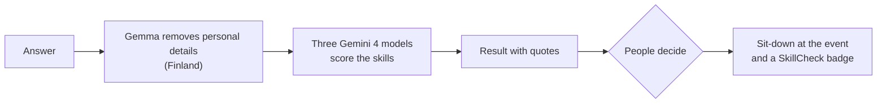

<p align="center">
  
  &nbsp;&nbsp;&nbsp;&nbsp;
  
</p>

<h1 align="center">SkillCheck</h1>

<p align="center"><b>No CV. No cover letter. Just talk about your skills.</b><br>
Fair skill checks for City of Espoo recruitment events.<br>
Junction 2026 · City of Espoo challenge "Rethinking Recruitment" · Team SkillCheck</p>

<p align="center"><a href="https://skillcheck.fi"><b>skillcheck.fi</b></a> · synthetic data only</p>

---

## The problem

Espoo's recruitment events bring hundreds of jobseekers and dozens of companies together. CVs are now often written by AI, so companies cannot see who can do the job.

## What SkillCheck does

- **One real task, not a job ad.** A company describes a problem from its work, or City staff do it with them.
- **In person, in rooms Espoo already has.** Jobseekers talk the task through on a supervised computer in an EXAM room, in spaces like Sello library or Espoo Talent Hub.
- **Personal details removed first.** Gemma 4 on our server in Finland replaces name, age, employer, places and origin before any other AI reads an answer.
- **A panel, not one model.** Three Gemini 4 models interview and score only the skills, with the candidate's own words as evidence.
- **People decide.** Companies see an alias and the evidence, and invite people to sit down at the event. An accepted check becomes a SkillCheck badge.



## Two apps in this repository

| Folder | What it is | Built with |
|---|---|---|
| `/` | **Platform.** Portals for jobseekers, companies and the City: events, bookings, skill checks, results, decisions, audit log | Next.js 16, TypeScript, PostgreSQL |
| `panel/` | **Interview panel** used by the platform | Rust |
| `demo/` | **Demo.** How it works, a live skill check and finished results | Rust server, SvelteKit |

## AI models

| Job | Model | Runs on |
|---|---|---|
| Privacy guard | Gemma 4 26B-A4B-it | Verda GPU, Finland |
| Interview and report | Gemini 4 Hydrogen, Argon and Carbon | Google, pseudonymised text only |
| Speech to text | Whisper large-v3-turbo | Verda GPU, Finland |

Open models are served with vLLM. The database is PostgreSQL on Aiven in Finland.

## Responsible by design

- **No automated decisions about people.** The AI gathers evidence. The company and the City decide.
- **Fair.** Personal details are removed before scoring. Accent and grammar never count. A split panel goes to a person.
- **Private.** Data stays in Finland, companies see aliases, contact only by consent, every access is in an append-only audit log, export and erasure for every jobseeker.

## Run it

**Platform**
```bash
cp .env.example .env.local      # database, model servers, API keys
npm install
npm run db:push && npm run db:seed
npm run dev
```

**Demo**
```bash
cd demo
python run.py dev               # needs Rust, bun and GEMINI_API_KEY in ~/.secrets/globals.json
```
Set `GUARD_BASE_URL` to a Gemma server so names are removed before Gemini reads an answer. Server setup: [infra/README.md](infra/README.md).

## Docs

| | |
|---|---|
| [Challenge](docs/CHALLENGE.md) | The Espoo challenge and how SkillCheck meets each criterion |
| [Architecture](docs/ARCHITECTURE.md) | System, one skill check and who decides, as diagrams |
| [Database](docs/DATABASE.md) | Every table and how personal data is protected |
| [Decisions](docs/DECISIONS.md) | Each design choice with research, pros and cons |
| [Research](docs/RESEARCH.md) | Facts and sources |
| [Panel API](docs/PANEL_API.md) | The interview panel service |
| [Demo server API](demo/SERVER_API.md) | The demo server and its privacy guard |

## License

MIT. See [LICENSE](LICENSE).
