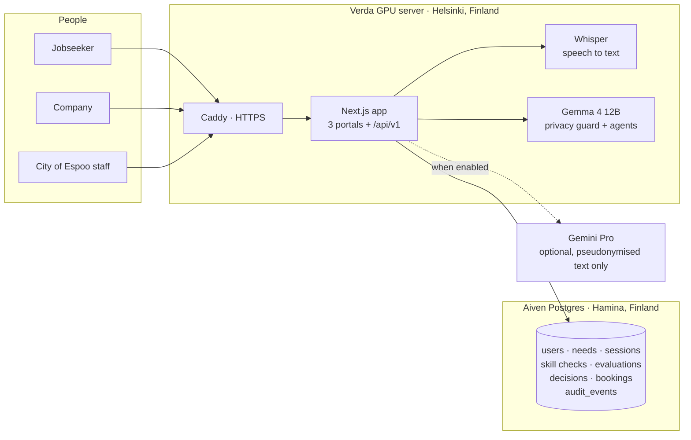
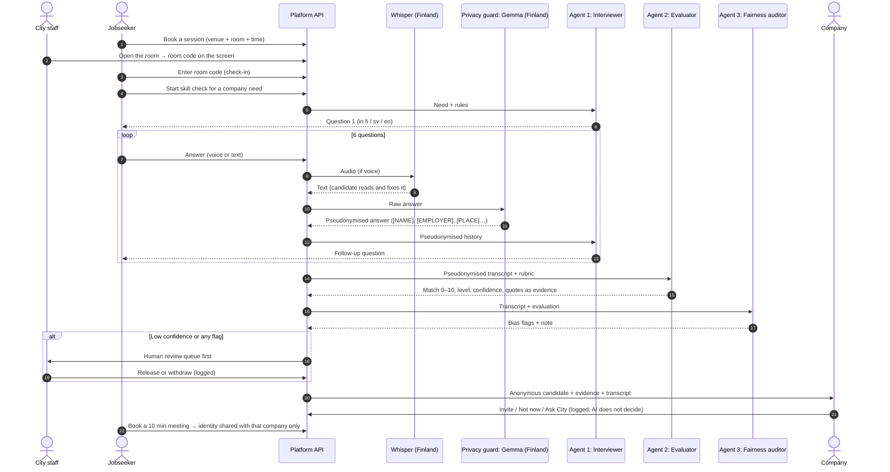

# Skill Check: architecture and status

Skill Check is a platform for the **City of Espoo**'s recruitment events. Jobseekers show how they think in a short AI-led conversation, held **at a venue or online room run by the City**. Companies get evidence instead of AI-written CVs, and **a person makes every decision**.

## 1. System

Everything personal stays in Finland. The AI models only ever read **pseudonymised** text. Raw answers live only in our database.

## 2. How a skill check flows

## 3. The three agents and their helpers

| | Role | Model (now) | Input | Output | Never does |
|---|---|---|---|---|---|
| Helper | **Speech to text** | Whisper large-v3-turbo, Verda | Audio (max 30 s) | Text the candidate can edit | Store audio |
| Helper | **Privacy guard** | Gemma 4 12B, Verda | Raw answer | Same text with personal details as tags | Change skills or numbers |
| Agent 1 | **Interviewer** | Gemma 4 12B (Gemini Pro when enabled) | Need + pseudonymised history | Next question, follows up on the answer | Ask about age, origin, family; judge out loud |
| Agent 2 | **Evaluator** | same | Pseudonymised transcript + rubric | Match, level, confidence, quotes per skill | Decide; score grammar or accent |
| Agent 3 | **Fairness auditor** | same | Transcript + evaluation | Flags + note → routes to human review | Decide |

Switch the thinking model with one setting: `INTERVIEW_PROVIDER=gemma | gemini`.

## 4. Where things are in the repo

| Area | What | Where |
|---|---|---|
| Data model | 18 tables, commented | `src/db/schema.ts` |
| Audit immutability | Trigger: audit_events + decisions are append-only | `src/db/sql/immutable-audit.sql` (`npm run db:audit`) |
| Demo data | Accounts, companies, needs, event, sessions | `src/db/seed.ts` (`npm run db:seed`) |
| Login + roles | Email login, server-set roles, JWT + bearer | `src/lib/auth.ts`, `src/lib/session.ts`, `src/app/actions/auth.ts` |
| Platform API | Auth wrapper + JSON errors | `src/lib/api.ts`, routes in `src/app/api/v1/` |
| Business rules | Needs, checks, sessions (venue rule), decisions, bookings, company views | `src/lib/services/*.ts` |
| GDPR | Access log, export, erasure | `src/lib/services/audit.ts`, `privacy.ts`, `/api/v1/me/*` |
| AI | Whisper, guard, interviewer, evaluator + fairness | `src/lib/ai/*.ts` |
| Jobseeker portal | Sessions, room check-in, skill check, results, meeting booking, my data | `src/app/[lang]/candidate/` |
| Company portal | Ranked anonymous candidates, evidence view, decisions, needs | `src/app/[lang]/company/` |
| City portal | KPIs, sessions + room screen, review queue, audit log | `src/app/[lang]/city/` |
| Languages | en / fi / sv routing + texts | `src/i18n/`, `src/proxy.ts` |
| Server | Gemma, Whisper, app, Caddy (HTTPS) | `infra/docker-compose.yml`, `Dockerfile`, `infra/Caddyfile`, guide in `infra/README.md` |

### API (`/api/v1`, cookie or bearer token)

| Role | Endpoints |
|---|---|
| Any | `GET /me`, `GET /needs`, `GET /sessions`, `GET /checks/:id` (view depends on role), `GET /events/:id/slots` |
| Jobseeker | `POST /sessions/:id/book`, `POST /sessions/:id/check-in`, `POST /checks`, `POST /checks/:id/answer`, `POST /transcribe`, `POST /bookings`, `GET /me/sessions`, `GET /me/audit`, `GET /me/export`, `DELETE /me` |
| Company | `POST /needs`, `GET /company/candidates`, `POST /checks/:id/decisions` (invite, not_now, needs_review) |
| City | `POST /sessions`, `PATCH /sessions/:id` (open/close), `GET /sessions/:id/code`, `GET /city/stats`, `GET /city/review`, `GET /city/audit`, `POST /checks/:id/decisions` (approve, reject) |

## 5. Status

### Done and tested
- Venue rule: no session, no room code, no skill check (13 API tests)
- Full journey across the three roles (25+ API tests, browser tests for each portal)
- Privacy guard in fi / sv / en, speech to text in fi / sv / en
- GDPR: access log, append-only audit (database refuses changes), export, erasure
- Role separation: each role has its own portal and API permissions

### Still needed
| Priority | Item | Why |
|---|---|---|
| Must | Live link on Verda with HTTPS | Judges and teammate can use it |
| Must | Reset Aiven password + IP allowlist | Password appeared in a screenshot |
| Must | Clean demo data before judging | Test runs left duplicates |
| Must | Portal texts in fi / sv | Landing is translated, portals are English |
| Must | README, pitch video ≤ 2 min, deck PDF, Verda process post, repo public | Submission rules |
| Should | Gemini Pro as the thinking model | Best Use of Gemini prize, better calibration |
| Should | Context.dev: company pastes website → AI drafts the need → company confirms | Context.dev prize, easier for companies |
| Should | ESCO skills mapping | Uses the challenge's suggested open data |
| Could | Modal sandbox code task for tech roles | Best use of Modal prize |
| Could | Video-of-work path for hands-on roles | Inclusion |
| Could | Inbound JWT verification for partner systems (Brella, Tavata) | Platform story |
