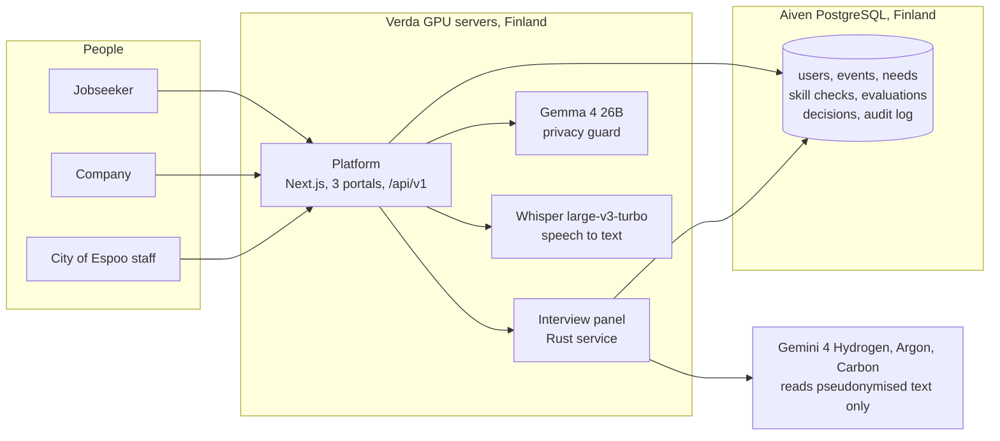
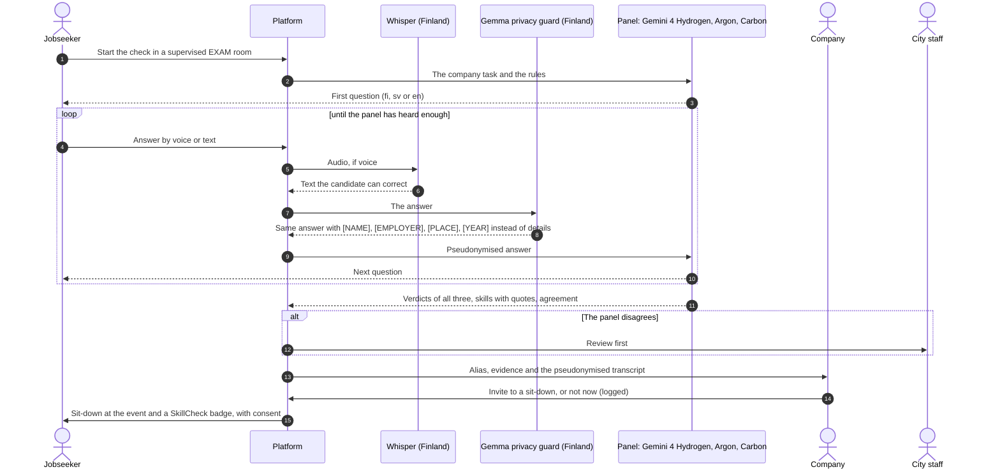
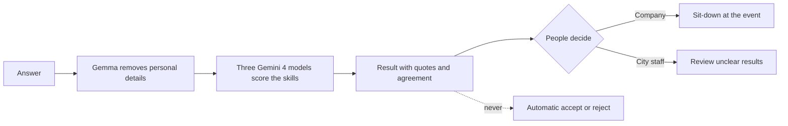

# Architecture

SkillCheck has two apps in this repository, built around the same interview panel and the same privacy guard.

- **Platform** (repository root): portals for jobseekers, companies and the City of Espoo. Events, bookings, skill checks, results, decisions and the audit log.
- **Demo** (`demo/`): a short story of how it works, a live skill check and finished results, for judges and visitors.

## 1. System

Everything personal stays in Finland. Gemini only ever reads answers after the privacy guard. Raw answers stay in our database.

## 2. One skill check

## 3. Who decides

The AI gathers evidence. The company and the City decide. Every decision and every access to personal data is written to an append-only audit log.

## 4. The panel

| Model | Role |
|---|---|
| Gemini 4 Hydrogen | Lead interviewer, job knowledge |
| Gemini 4 Argon | Problem solving, how the candidate reasons |
| Gemini 4 Carbon | Authenticity, real experience |

After every answer each model writes a private note and proposes a question. One of them asks the next question. The interview ends when the panel can assess every skill, within a set limit of questions. Agreement between the three becomes the confidence. A split panel suggests a human review.

## 5. Where things are

| Area | Where |
|---|---|
| Platform pages and portals | `src/app/[lang]` |
| Business rules | `src/lib/services` |
| Privacy guard, speech, panel client | `src/lib/ai` |
| Database tables | `src/db/schema.ts` and [DATABASE.md](DATABASE.md) |
| Interview panel service | `panel/` and [PANEL_API.md](PANEL_API.md) |
| Demo server and front end | `demo/` and [demo/SERVER_API.md](../demo/SERVER_API.md) |
| Servers and deploy | `infra/` |
| Decisions and research | [DECISIONS.md](DECISIONS.md), [RESEARCH.md](RESEARCH.md) |
