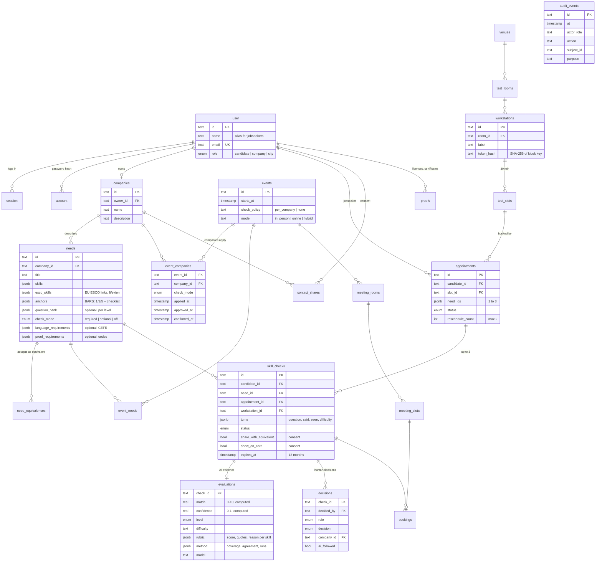

# Database

## The stack in one table

| Layer | What it is | In this project |
|---|---|---|
| **PostgreSQL 18** | The database engine: stores tables and rows, enforces rules (keys, triggers) | Our only database. Extension **pgvector** enabled for similarity search |
| **Aiven** | Managed hosting for Postgres: backups, high availability, security updates, monitoring | Service `pg-20d0a38b`, Google Cloud **europe-north1 (Hamina, Finland)**, 2 nodes, 14-day point-in-time backups |
| **Drizzle ORM** | A TypeScript library in our code. Tables are defined in code; queries are type-checked | `src/db/schema.ts` (tables), `src/db/index.ts` (connection), used by every service |
| **drizzle-kit** | Command-line tool that applies `schema.ts` to the database and opens a browser viewer | `npm run db:push`, `npm run db:studio` |

The web app (laptop or Verda server) connects to Aiven over an **encrypted** connection (`sslmode=require`). Laptop and live site share **the same database**.

## Entity relationship diagram

## Tables by area (27 tables)

| Area | Tables | Purpose |
|---|---|---|
| **Login** | `user`, `session`, `account`, `verification`, `jwks` | Managed by Better Auth. `account.password` is a hash. `jwks` holds the JWT signing keys (private key encrypted) |
| **Companies** | `companies`, `needs`, `need_equivalences` | A company's needs: skills, ESCO links, BARS anchors, optional questions, skill check mode. Equivalences = "results from that need count for us too" |
| **Events** | `events`, `event_companies`, `event_needs`, `meeting_rooms`, `meeting_slots` | City events. Companies apply → City approves → company confirms (≥ 1 week before). 10-minute meeting slots |
| **Testing rooms** | `venues`, `test_rooms`, `workstations`, `test_slots`, `appointments` | EXAM-room model. A booking = jobseeker + 30-minute slot on one workstation + 1–3 needs |
| **Skill checks** | `skill_checks`, `evaluations` | The conversation (raw and pseudonymised), the AI evidence and the separate language assessment |
| **Official proofs** | `proofs` | Licences, cards, degrees, language certificates. Declared by the jobseeker, verified by City staff in person. No document copies |
| **Human decisions** | `decisions`, `bookings`, `contact_shares` | Accept / not this time (City or company), meeting bookings, contact-sharing consent |
| **GDPR** | `audit_events` | Every access to or change of personal data |
| Not used yet | `video_submissions` | Planned video-of-work path |

## How personal data is protected in the database

| Protection | Where | How |
|---|---|---|
| **Raw vs pseudonymised answers** | `skill_checks.turns` | Each answer is stored as `said` (raw, only for the jobseeker and the City) and `seen` (pseudonymised, the only version AI agents and companies get) |
| **Companies never see identity** | queries in `services/` | Companies get an alias derived from the user id (`lib/alias.ts`), never `user.name` or `user.email`. Contact only via `contact_shares` (consent) |
| **Append-only audit** | `audit_events`, `decisions` | Database triggers (`src/db/sql/immutable-audit.sql`) reject **UPDATE, DELETE and TRUNCATE**, even from our own app |
| **Kiosk keys** | `workstations.token_hash` | Only a SHA-256 hash is stored; the key itself lives only in the City computer's cookie |
| **Passwords** | `account.password` | Hashed by Better Auth |
| **Retention** | `skill_checks.expires_at` | 12 months after the check |
| **Erasure** | `services/privacy.ts` | Name, email, password and answers are wiped; scores, decisions and the audit trail stay without identity |
| **Location** | Aiven | Data and backups in Finland (`google-europe-north1`) |

## Working with the database

| Task | Command / place |
|---|---|
| Browse every table in the browser | `npm run db:studio` → https://local.drizzle.studio |
| Terminal SQL | `psql "$(grep ^DATABASE_URL .env.local \| cut -d= -f2-)"` |
| Change a table | Edit `src/db/schema.ts`, then `npm run db:push` |
| Re-apply audit triggers | `npm run db:audit` |
| Fresh demo data | `npm run db:reset -- --yes && npm run db:seed` |
| Metrics, backups, users, IP allowlist | console.aiven.io → `pg-20d0a38b` |

**Conventions:** primary keys are random UUIDs (text). Every table has a `created_at`. JSON columns (`jsonb`) hold structured data that is read as a whole (answers, rubric, anchors). Foreign keys use `ON DELETE CASCADE` only where the child cannot exist alone; audit tables never cascade.

## Production notes (not done in the demo)
- The app should connect as a **restricted database user** without `ALTER` or `TRUNCATE` rights; today it uses the admin user, which could disable the audit triggers.
- Restrict the Aiven **IP allowlist** to the Verda server, and rotate the password.
- A scheduled job should delete `skill_checks` past `expires_at`.
