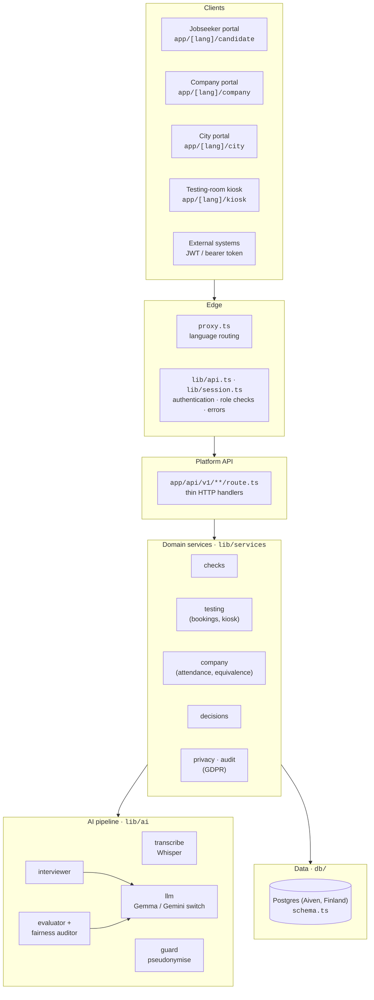
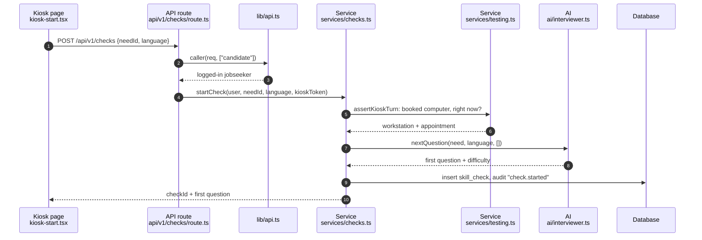

# Repository structure

## Layers

Every feature passes through the same layers. Pages and API routes stay thin, the rules live in **services**, so the web portals, the kiosk and external systems all follow the same rules.

## Folders

| Path | Layer | Contents |
|---|---|---|
| `src/app/[lang]/` | Clients | All pages, served under `/en`, `/fi`, `/sv`. One folder per role, plus `kiosk/`, `login/`, `signup/` |
| `src/app/api/v1/` | API | Platform API. Folder = URL, `route.ts` = handler. Calls services only |
| `src/app/actions/` | API | Server actions for forms (log in, sign up, log out, kiosk login rule) |
| `src/proxy.ts` | Edge | Redirects visitors to their browser language |
| `src/lib/api.ts` | Edge | Wraps API routes: identifies the caller, checks the role, returns clean JSON errors |
| `src/lib/session.ts` | Edge | `requireRole()` protects a page in one line |
| `src/lib/auth.ts` | Edge | Better Auth setup: email login, server-set roles, JWT + bearer tokens |
| `src/lib/services/` | Domain | Business rules: `checks`, `testing`, `company`, `decisions`, `needs`, `privacy`, `audit` |
| `src/lib/ai/` | AI | `transcribe`, `guard`, `interviewer`, `evaluator`, `llm` |
| `src/lib/esco.ts` | AI / open data | Maps company skills to the EU ESCO taxonomy |
| `src/db/` | Data | `schema.ts` (all tables), `seed.ts`, `reset.ts`, `sql/` (audit triggers) |
| `src/components/ui/` | Clients | Base UI components (shadcn/ui) |
| `src/components/app/` | Clients | Skill Check components: check runner, evidence view, decision panel, kiosk guard |
| `src/i18n/` | Clients | Texts in English, Finnish and Swedish |
| `infra/` | Operations | `docker-compose.yml` (Gemma, Whisper, app, Caddy), `Caddyfile`, `deploy.sh`, `tunnel.sh`, server guide |
| `Dockerfile` | Operations | Production image of the web app |
| `docs/` | Documentation | Handover, checklist, architecture, spec, research, this file |

## One feature through the layers: "start a skill check"

## Conventions
- Routes never contain business rules. They authenticate, parse input and call a service.
- Services never read cookies or headers directly. Request data (like the kiosk token) is passed in.
- Every access to personal data writes an audit record (`services/audit.ts`).
- AI calls go through `lib/ai/llm.ts`, so the model can be switched with one setting.
